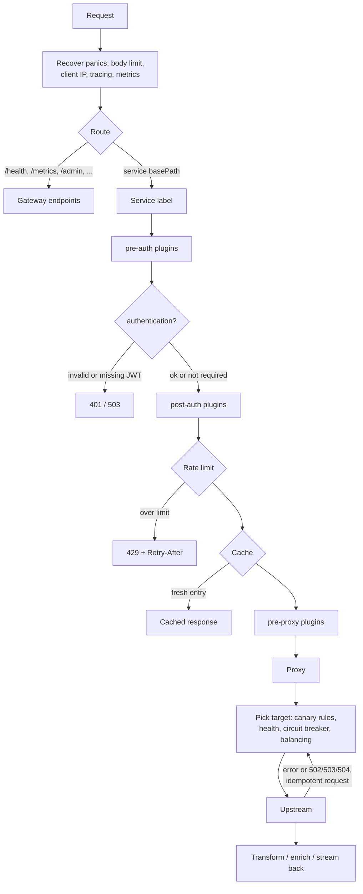

# Concepts

## Services and targets

A **service** is a path prefix (`basePath`) and the upstreams (`targets`) that serve it. A
request whose path is `basePath` or starts with `basePath/` belongs to that service:

```yaml
services:
  - name: users
    basePath: /api/users          # /api/users and /api/users/...
    targets:
      - http://users-1:8081       # spread across targets (round-robin or random)
      - http://users-2:8081
    stripBasePath: true           # /api/users/7 is sent upstream as /7
```

Targets are base URLs and may carry a path (`http://users:8081/v2`), which is prepended. The
service name labels metrics and logs and is part of rate-limit keys.

A service's `protocol` is `http` (the default), `graphql` or `grpc`. HTTP services get the full
request pipeline below; WebSocket upgrades on an HTTP service are proxied as WebSockets.

## The request pipeline



The order is fixed and deliberate: nothing, not even the cache, can answer a request for an
authenticated service before its token has been checked. Middleware [plugins](plugins.md) run at the three
plugin steps, on service routes only. Global steps (panic recovery, body
limit, tracing and metrics) wrap every request, including the gateway's own endpoints.

### Error responses

When the gateway itself answers with an error, the body is JSON with a `message`, for example
`{"message": "Upstream timed out"}` with a 504; a `HEAD` request gets the status only. An error's
internal text (such as an upstream address) is logged, not sent: an unexpected error is a 500
with `{"message": "Internal Server Error"}`. Server errors (5xx) are logged at error level with
the method, path and status; client errors only at debug level. Responses that come from an
upstream, including its errors, are passed through unchanged.

## Gateway endpoints

| Path | What |
| --- | --- |
| `/health`, `/ready`, `/live` | Health, readiness and liveness (always 200 while running) |
| `/metrics` | Prometheus metrics (`monitoring.enabled`) |
| `/aggregate?services=a,b` | Calls several services and returns their JSON together |
| `/admin` | Admin interface (`admin.enabled`) |
| `/debug/routes`, `/debug/config` | Route list and version (`server.debugEndpoints`) |
| `/openapi.json`, `/openapi.yaml`, `/openapi` | [OpenAPI document](openapi.md) and Swagger UI (`openapi.enabled`, `openapi.uiEnabled`) |

## Configuration lifecycle

Odin reads its configuration once, at startup:

1. The main file (`-config`, default `config/config.yaml`), then `services.yaml` from the same
   directory if it exists. A service defined in both keeps the main file's definition.
2. `${NAME}` and `${NAME:-default}` are replaced with environment variables. A reference to an
   unset variable without a default stops startup with its name.
3. Defaults are filled in and the result is validated: invalid targets, empty names or base
   paths, and bad regular expressions stop startup with a message.

Changes take effect on restart. `SIGHUP` checks the file and logs whether it is valid; live
reload is planned. The admin interface edits the same file, so its changes also apply on
restart.

## Where state lives

- Rate-limit counters and cached responses: in memory (`strategy: local`) or in Redis
  (`strategy: redis`), which all gateway instances share.
- Health and circuit-breaker state: per gateway instance, in memory.
- Uploaded plugins and integration settings: MongoDB, when `mongodb.enabled`.
