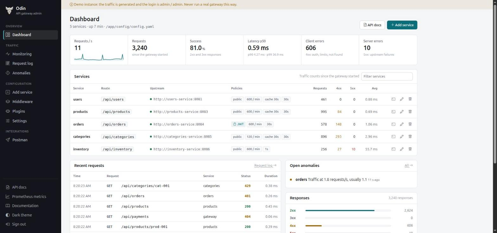
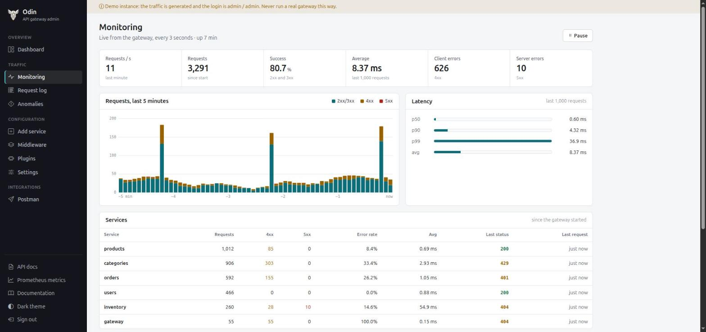
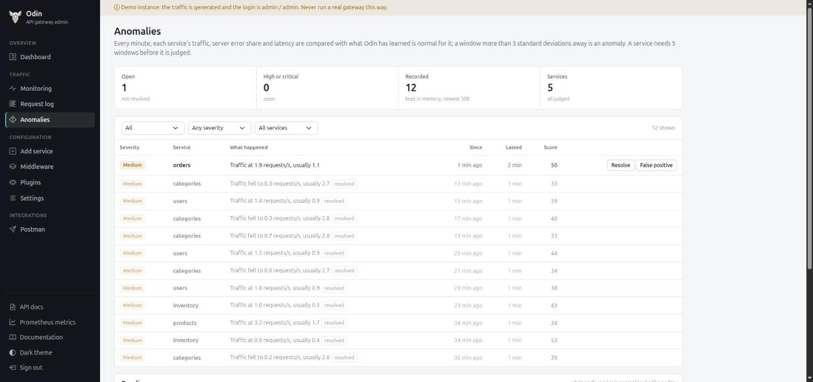
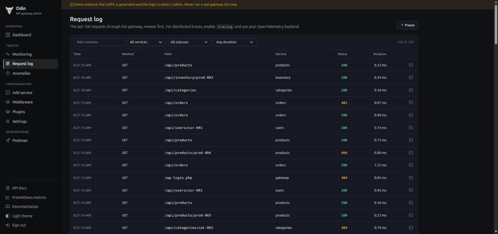
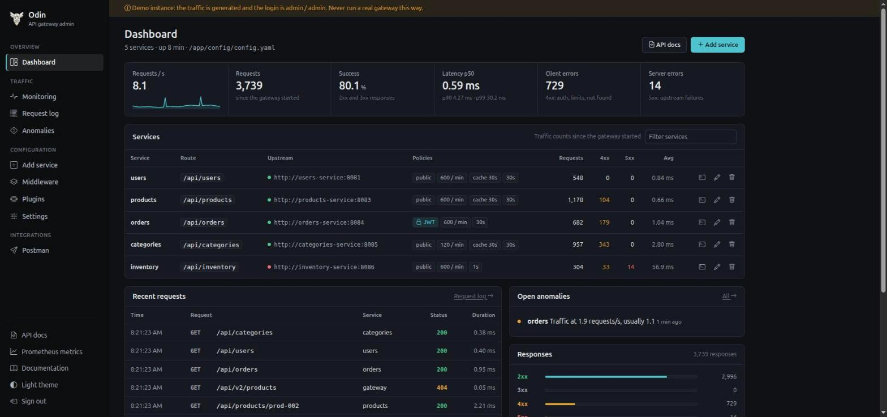

# Demo

Three ways to see Odin, from a look to a running gateway.

## Run it in your browser

[](https://codespaces.new/sepehrmohseni/odin?quickstart=1)

A codespace starts the quickstart stack in demo mode: Odin with Redis, MongoDB, five demo
services and a generator that keeps sending traffic, so the admin has something to show. The
first start builds the images and takes a few minutes; the terminal then prints the links.

- Open the forwarded port 8080 and go to `/admin`. Sign in with **admin** / **admin**.
- `/openapi` has the API documentation of the demo routes, generated by Odin.
- In the codespace's terminal, `curl -i localhost:8080/api/products` goes through the gateway.

The forwarded port is private to you. The codespace's time counts against your own GitHub
account (personal accounts include a monthly allowance); stop or delete it when you are done.

## Run it on your machine

With Docker and Compose v2:

```bash
git clone https://github.com/sepehrmohseni/odin.git && cd odin
scripts/quickstart.sh --demo          # admin / admin, generated traffic
scripts/quickstart.sh --down          # stop
```

Without `--demo`, the [quickstart](getting-started.md) uses random secrets and no generated
traffic. Delete `.env` after a demo to go back to that.

## What the demo shows

The traffic generator sends a mix a real gateway sees: listings and lookups, orders with signed
JWTs, requests without a token or with a bad one (401), unknown paths (404), and every two minutes
a burst against the categories service, whose limit is 120 requests a minute (429). The
inventory service is deliberately unreliable: some of its responses fail or come too late for
its one-second timeout, and for 30 seconds in every three minutes it is down for maintenance,
which its health check reports.

### Dashboard

Live totals, every service with its route, upstream health, the policies the gateway applies and
its traffic, and the open anomalies.



### Monitoring

Requests over the last five minutes by status class, latency percentiles, per-service error
rates, and the state of every health-checked target.



### Anomalies

Odin learns each service's normal traffic, server error share and latency, and reports windows
that fall far outside them. In the demo, the generator's swings and bursts show up as traffic
spikes and drops.



### Request log

The last 100 requests, filterable by path, service, status and duration; each can be copied as
a curl command. The admin follows the system's light or dark setting:





## The demo's API, as Odin describes it

This is the OpenAPI document Odin generates for the quickstart configuration
([config/compose.yaml](https://github.com/sepehrmohseni/odin/blob/main/config/compose.yaml)), the same one the
running stack serves at `/openapi`. Here it is a static copy, so "Try it out" is off.

<iframe class="odin-api-frame" src="api.html" title="OpenAPI document of the Odin quickstart" loading="lazy"></iframe>

[Open it on its own page](demo/api.html){ target="_blank" }
