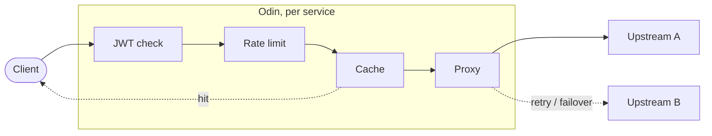

---
hide:
  - navigation
  - toc
---

# Odin API Gateway

<p class="lede">
An API gateway written in Go. Odin sits in front of your HTTP, WebSocket and GraphQL services
and handles authentication, rate limits, caching, retries and health checks, with Prometheus
metrics, OpenTelemetry traces and an optional web admin.
</p>

[Get started](getting-started.md){ .md-button .md-button--primary }
[Configuration reference](reference/configuration.md){ .md-button }

## Try it

```bash
git clone https://github.com/sepehrmohseni/odin.git && cd odin
scripts/quickstart.sh                         # Odin, Redis, MongoDB and demo backends in Docker
curl http://localhost:8080/api/products       # proxied
curl -i http://localhost:8080/api/orders      # 401: this route needs a JWT
```

The script prints the admin login. A service is a few lines of YAML:

```yaml
services:
  - name: products
    basePath: /api/products
    targets: [http://products-1:8080, http://products-2:8080]
    authentication: true
    rateLimit: {limit: 100, window: 1m}
    healthCheck: {enabled: true, path: /health}
```

## How a request flows



Every service gets its own route group. Authentication runs before anything else can answer,
then the rate limit, then the response cache, then the proxy. The proxy picks a healthy target,
retries idempotent requests on another one, and streams the response back.
[Concepts](concepts.md) explains each step.

## What it does today

<div class="columns" markdown>
<div markdown>
**Routing**

Path-prefix services, round-robin or random targets, base-path stripping, static headers,
`X-Forwarded-*` headers, canary splits by header, cookie or weight.
</div>
<div markdown>
**Resilience**

Upstream timeouts, retries with failover for idempotent requests, active health checks, and a
circuit breaker per target.
</div>
<div markdown>
**Security**

JWT per service (HMAC, expiry required, optional issuer and audience), body limits, trusted
proxies, and an admin interface that is off by default.
</div>
<div markdown>
**Traffic**

Rate limits per service and client, in memory or Redis, with fixed window, sliding window or
token bucket.
</div>
<div markdown>
**Transformation**

Go-template rewrites of headers, query and body; JSON field mapping; enrichment from dependent
services; response caching that respects `Cache-Control`.
</div>
<div markdown>
**Observability**

Prometheus metrics per service, OpenTelemetry traces with context propagation, structured
access logs, and `/health`, `/ready` and `/live`.
</div>
<div markdown>
**Plugins**

Go and sandboxed WebAssembly middleware in three phases of each service's pipeline, ordered by
priority and limited to routes.
</div>
<div markdown>
**API description**

A generated OpenAPI 3 document of your routes, or your own, with Swagger UI.
</div>
</div>

<p class="status">
Odin is at 0.1. The configuration format may still change before 1.0; the
<a href="changelog/">changelog</a> lists every change you need to check when upgrading. Planned
work, including gRPC transcoding, OIDC and live reload, is on the
<a href="roadmap/">roadmap</a>, and the <a href="AUDIT/">audit</a> records what was found and
fixed.
</p>
