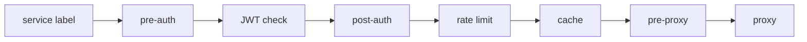

# Plugins

Odin runs Go plugins: shared objects built with `go build -buildmode=plugin` against the same Go
release and the same versions of Odin's packages as the gateway binary. A plugin runs inside the
gateway process with full access, so load only plugins you trust.

!!! note
    The Docker image is built without cgo and cannot load Go plugins. Use a binary built with
    `CGO_ENABLED=1` on a glibc system.

There are two kinds of plugins: **middleware plugins**, which sit in a service's request
pipeline, and **hook plugins**, which are called at fixed points of every request.

## Middleware plugins

A middleware plugin wraps the next handler, like Echo middleware:

```go
package main

import (
    "net/http"

    "odin/pkg/plugins"
    "github.com/labstack/echo/v4"
)

type apiKey struct{ key string }

func (a *apiKey) Name() string                            { return "api-key" }
func (a *apiKey) Version() string                         { return "1.0.0" }
func (a *apiKey) Initialize(map[string]interface{}) error { return nil }
func (a *apiKey) Cleanup() error                          { return nil }
func (a *apiKey) Handle(next echo.HandlerFunc) echo.HandlerFunc {
    return func(c echo.Context) error {
        if c.Request().Header.Get("X-API-Key") != a.key {
            return echo.NewHTTPError(http.StatusUnauthorized, "missing or wrong API key")
        }
        return next(c)
    }
}

// New is called with the plugin's configuration when it is enabled.
func New(config map[string]interface{}) (plugins.Middleware, error) {
    key, _ := config["key"].(string)
    return &apiKey{key: key}, nil
}
```

Build it inside a checkout of the same Odin version: `go build -buildmode=plugin -o api-key.so
./path/to/plugin`. Exporting `var Middleware plugins.Middleware` instead of `New` also works;
then `Initialize` receives the configuration. Three examples (API keys, request logging, header
rewriting) are in `examples/middleware-plugins`; `examples/middleware-plugins/build.sh` builds
them.

### Phases

Each middleware plugin runs in one phase of every service route whose path matches its routes:



| Phase | Runs | Typical use |
| --- | --- | --- |
| `pre-auth` | before the JWT check | API keys, request signatures, IP rules |
| `post-auth` (default) | after authentication, before rate limits and the cache; `user_id` is set | per-user rules, request rewriting |
| `pre-proxy` | after the cache, only for requests that reach an upstream | upstream headers, response wrapping |

Within a phase, plugins run by priority (lower first), then by name. Routes are path patterns:
`*` (every service route), an exact path, a prefix `/api/*` (matches `/api` and `/api/...`, not
`/apiary`) or a glob such as `/api/*/orders`. Plugins never run on the gateway's own endpoints
(`/admin`, `/health`, `/metrics`).

A plugin that panics fails only that request, with a 500 and the plugin's name in the log.
Enabling and disabling take effect on the next request, without a restart.

### Enabling middleware plugins

- **Upload** (admin, **Plugins**, needs MongoDB): upload the `.so` with a name, version, priority,
  phase, routes and a JSON config, then enable it. The upload is checked without running it: it
  must be an ELF shared object for the gateway's architecture, built with `-buildmode=plugin` and
  the gateway's Go release, exporting `New` or `Middleware`. Its SHA-256 is stored and checked
  again before it is enabled. Enabled uploads are activated again at startup.
- **Plugin records** (admin API `POST /admin/api/plugins` with `"pluginType": "middleware"`,
  `"appliedTo"`, `"priority"`, `"phase"`): the binary must be in the plugins directory
  (`plugins.directory`, default `/var/odin/plugins`).

Plugin names may only contain letters, digits, `.`, `_`, `+` and `-`.

## Hook plugins

A hook plugin exports `var Plugin` implementing:

```go
type Plugin interface {
    Name() string
    Version() string
    Initialize(config map[string]interface{}) error
    PreRequest(ctx context.Context, pluginCtx *plugins.PluginContext) error
    PostRequest(ctx context.Context, pluginCtx *plugins.PluginContext) error
    PreResponse(ctx context.Context, pluginCtx *plugins.PluginContext) error
    PostResponse(ctx context.Context, pluginCtx *plugins.PluginContext) error
    Cleanup() error
}
```

```yaml
plugins:
  enabled: true
  directory: /var/odin/plugins
  plugins:
    - name: request-logger
      path: /var/odin/plugins/request_logger.so
      enabled: true
      hooks: [pre-request, post-request, pre-response, post-response]
      config:
        level: info
```

| Hook | When |
| --- | --- |
| `pre-request` | before routing; returning an error stops the request |
| `post-request`, `pre-response` | when the response status is known, just before the headers are written |
| `post-response` | after the response has been written |

`PluginContext` has the method, path and request headers, and once known the service name, the
authenticated user and the response status (`Metadata["status"]`). Returning an
`*echo.HTTPError` from `PreRequest` rejects the request with that status. Hook plugins run for
every request when `plugins.enabled` is true. See `examples/plugins/request_logger.go`
(`make build-plugins`).

Programs that embed the gateway can register plugins compiled into them, without shared objects:
`gateway.Plugins().RegisterMiddleware(...)` and `RegisterPlugin(...)`.

## Performance

The pipeline costs a slice read per phase, plus about two allocations for each plugin that
matches. On an Intel Core i5-10500 with six cores given to Docker, a proxied `GET` through the
whole gateway to a local backend took 210 to 255 µs with zero, three or nine pass-through
plugins, and allocations grew from 133 to 151 per request; the time differences were within
run-to-run noise, because the loopback HTTP call dominates. To reproduce:

```bash
scripts/docker-check.sh -- go test -run x -bench PluginPipeline -benchmem ./test/unit/pkg/gateway/
```

The reasoning behind the phases is in the [design note](design/plugin-pipeline.md).
